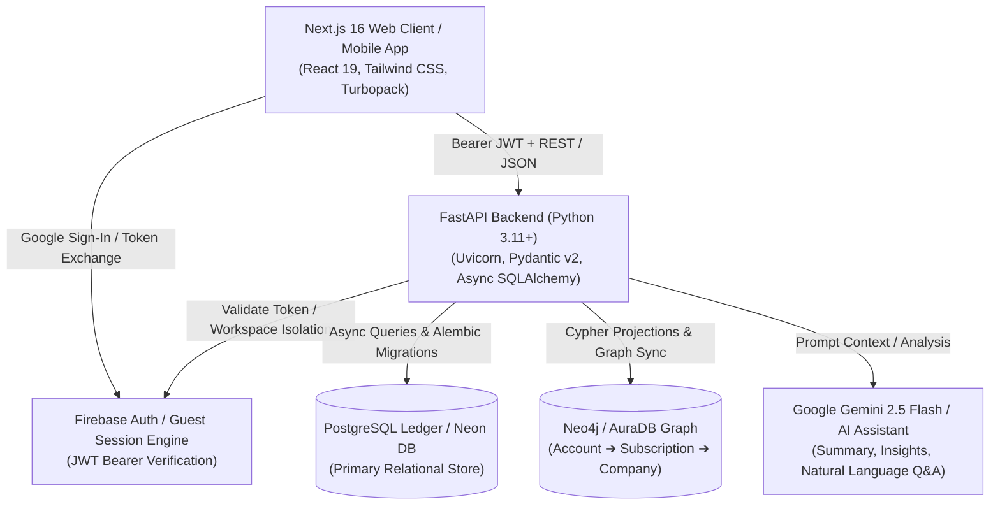
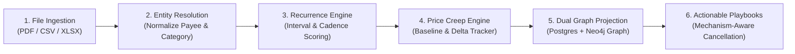
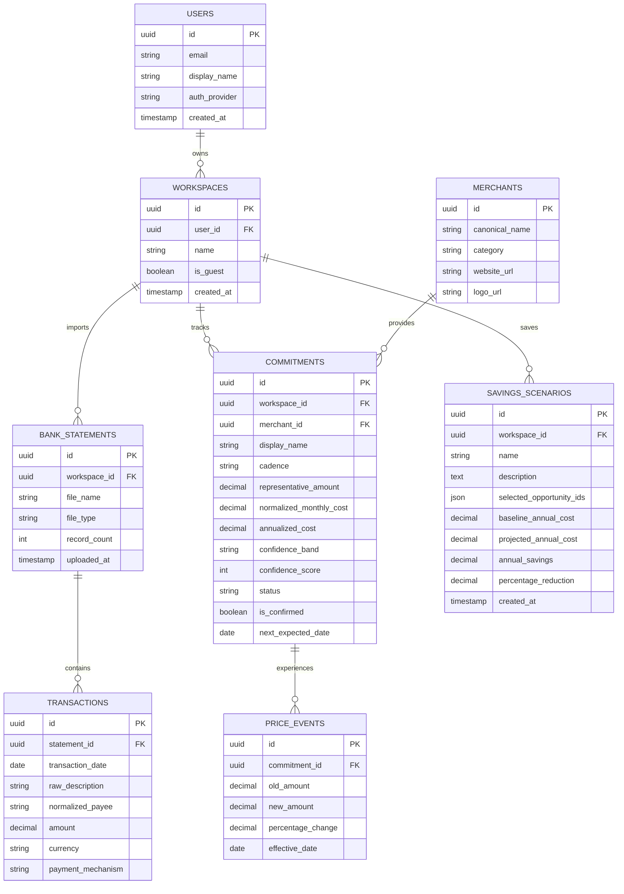

# PayScope — Comprehensive App Specification & Product Guide

> **Document Type:** Product Requirement Document (PRD) & Technical Engineering Specification  
> **Application Name:** PayScope  
> **Tagline:** Unlock clarity with every payment.  
> **Target Platforms:** Web (Next.js 16 App Router) & Mobile (React Native / Flutter Roadmap)  
> **Document Version:** 2.0 (Production Blueprint)

---

## Table of Contents
1. [Executive Summary & App Vision](#1-executive-summary--app-vision)
2. [Core Principles & Privacy-First Architecture](#2-core-principles--privacy-first-architecture)
3. [End-to-End System Architecture](#3-end-to-end-system-architecture)
4. [How PayScope Works: The 6-Stage Operational Pipeline](#4-how-payscope-works-the-6-stage-operational-pipeline)
5. [Complete Screen & Feature Breakdown](#5-complete-screen--feature-breakdown)
   - [5.1 Landing Page & Navigation (`/`)](#51-landing-page--navigation-)
   - [5.2 Main Dashboard (`/dashboard`)](#52-main-dashboard-dashboard)
   - [5.3 Spending Analysis Tab (`/financial-impact`)](#53-spending-analysis-tab-financial-impact)
   - [5.4 Savings Calculator & What-If Planner (`/savings`)](#54-savings-calculator--what-if-planner-savings)
   - [5.5 Subscriptions & Commitments Directory (`/commitments`, `/commitments/[id]`)](#55-subscriptions--commitments-directory-commitments-commitmentsid)
   - [5.6 Cancellation Assistant & Mechanism-Aware Playbooks (`/cancellations`)](#56-cancellation-assistant--mechanism-aware-playbooks-cancellations)
   - [5.7 Knowledge Graph & Relationship Explorer (`/relationships`)](#57-knowledge-graph--relationship-explorer-relationships)
   - [5.8 Merchant Directory & Payee Profiles (`/merchants`, `/merchants/[id]`)](#58-merchant-directory--payee-profiles-merchants-merchantsid)
   - [5.9 Statement Upload & Data Ingestion Centre (`/upload`)](#59-statement-upload--data-ingestion-centre-upload)
   - [5.10 AI Assistant Workspace Panel (`AIWorkspacePanel`)](#510-ai-assistant-workspace-panel-aiworkspacepanel)
6. [Database Schema & Data Models](#6-database-schema--data-models)
7. [REST API Endpoints Specification](#7-rest-api-endpoints-specification)
8. [Mobile App Blueprint (React Native / Flutter Roadmap)](#8-mobile-app-blueprint-react-native--flutter-roadmap)
9. [Design System & Theme Specifications](#9-design-system--theme-specifications)
10. [Step-by-Step Build & Implementation Checklist](#10-step-by-step-build--implementation-checklist)

---

## 1. Executive Summary & App Vision

### 1.1 The Problem
In the modern digital subscription economy, individuals and households face rampant **subscription sprawl**, **stealth price creep**, and **zombie recurring charges**:
- **Forgotten & Underutilized Subscriptions:** The average digital consumer subscribes to 10–18 recurring services (streaming, cloud storage, SaaS, fitness, news, delivery passes). Up to 35% of these go unused for months.
- **Silent Price Creep:** Companies routinely increase monthly and annual subscription fees by \$1 to \$4 without explicit user re-authorization. Users fail to notice the compounding impact on annual expenses.
- **Intentionally Deceptive Cancellation Friction (Dark Patterns):** Unsubscribing often requires navigating hidden settings, contacting customer support, or revoking auto-debit mandates across differing financial rails (UPI AutoPay, Credit Card recurring tokens, NACH e-mandates, App Store subscriptions).
- **Privacy Invasion of Traditional Aggregators:** Existing personal finance tools require users to hand over their primary bank net banking passwords or link sensitive Plaid/Yodlee accounts, creating massive attack surfaces and privacy concerns.

### 1.2 The PayScope Solution
**PayScope** is a privacy-first, offline-capable recurring payment intelligence platform. It analyzes synthetic and imported bank statements, detects every fixed and variable subscription, exposes stealth price creep, visualizes payments in an interactive knowledge graph, calculates potential savings, and provides mechanism-aware cancellation guides—**all without ever connecting to live bank credentials**.

```
┌────────────────────────────────────────────────────────────────────────┐
│                              PayScope                                  │
│                                                                        │
│   [Bank Statement Import] ──► [Recurrence Detection Engine]            │
│   (PDF / CSV / XLSX / JSON)              │                             │
│                                          ▼                             │
│   ┌──────────────────────────────────────────────────────────────┐     │
│   │  • Recurring Subscriptions Directory                         │     │
│   │  • Spending Analysis (Monthly & Yearly normalized spend)     │     │
│   │  • Stealth Price Creep & Anomaly Alerts                      │     │
│   │  • Interactive Knowledge Graph (Neo4j / SVG Projection)      │     │
│   │  • What-If Savings Calculator (Accurate, non-double-counted) │     │
│   │  • Mechanism-Aware Cancellation Playbooks (UPI, Cards, NACH) │     │
│   │  • Embedded AI Financial Assistant                           │     │
│   └──────────────────────────────────────────────────────────────┘     │
└────────────────────────────────────────────────────────────────────────┘
```

---

## 2. Core Principles & Privacy-First Architecture

1. **Zero Bank Credential Exposure:** PayScope never asks for internet banking usernames, passwords, OTPs, or debit card PINs. It processes exported bank statement files (PDF, CSV, XLSX) or synthetic test records.
2. **Strict Workspace Isolation:** Every user session (Google-authenticated or Guest) is sandboxed in its own tenant workspace. Queries, database rows, caches, and graph projections are strictly filtered by `workspace_id`.
3. **Deterministic Math & Verified Statements:** Financial amounts, savings figures, and annualized costs are derived deterministically from actual statement line items. Mathematical calculations protect against double counting and arbitrary inflation.
4. **Mechanism-Aware Actionability:** A subscription is not merely a name and an amount; it exists on a specific payment rail (UPI AutoPay, Credit Card Token, NetBanking NACH, Apple App Store, Google Play Store). PayScope gives exact steps to cancel each specific channel.
5. **Dark Mode Fintech Aesthetic:** Designed with a sleek, cinematic, modern dark theme (`#040711` background, `#0D1322` surfaces, `#FF5500` fiery orange accents, `#00E0E0` bright cyan highlights, and `#F4F7FB` crisp white typography).

---

## 3. End-to-End System Architecture



### 3.1 Technology Stack

| Layer | Technologies Used | Description |
|---|---|---|
| **Frontend Framework** | **Next.js 16.4+ (App Router)** | Server Components, Client Components, Turbopack bundling |
| **UI Library** | **React 19, Tailwind CSS v3.4** | Modern responsive dark theme, micro-animations |
| **Icons & Brand Badges** | **Custom Brand SVGs & Lucide Icons** | SVG brand badges (Netflix, Spotify, Google, OpenAI, etc.) |
| **Backend Framework** | **FastAPI (Python 3.11+)** | High-performance async REST API with automatic OpenAPI docs |
| **ORM & Migrations** | **SQLAlchemy 2.0 (Async) + Alembic** | Schema migrations, connection pooling, typed models |
| **Primary Database** | **PostgreSQL 16 (Neon Serverless)** | Relational storage for users, statements, transactions, commitments |
| **Graph Database** | **Neo4j 5.x / Neo4j AuraDB** | Cypher-powered property graph for deep relationship exploration |
| **Authentication** | **Firebase Auth + Signed Guest Sessions** | Google OAuth verification and zero-friction 24-hr guest demo tokens |
| **Data Parsing** | **pdfplumber, openpyxl, pandas** | High-precision PDF table and Excel/CSV tabular parsing |
| **AI Co-pilot** | **Google Gemini 2.5 Flash SDK** | Semantic document summarization and financial insights |

---

## 4. How PayScope Works: The 6-Stage Operational Pipeline



### Stage 1: Document Ingestion & Tabular Parsing
- The user uploads a bank statement in PDF, CSV, XLSX, or JSON format.
- The system automatically detects headers: Date, Description/Narrative, Amount, Debit/Credit indicator, Balance, and Reference Number.
- For PDF statements, `pdfplumber` extracts table boundaries, ignores headers and footers, and preserves row alignment across multi-page tables.
- Built-in sanity checks verify that debits are strictly positive and that synthetic data flags are confirmed.

### Stage 2: Payee Normalization & Entity Resolution
- Raw transaction descriptions (e.g. `UPI/50392819/NETFLIX ENTERTAINMENT/MUMBAI`) contain noise, bank IDs, and location tokens.
- PayScope strips reference codes, uppercase strings, and payment gateway prefixes (`UPI/`, `ACH/`, `POS/`, `NEFT/`).
- Fuzzy string matching and canonical merchant dictionary lookups match raw strings to curated company profiles (e.g., `Netflix India`, `Spotify India`, `Amazon Prime`, `Swiggy One`).
- Category classification tags the spend (Streaming, Cloud & SaaS, Fitness, Utilities, Insurance).

### Stage 3: Recurrence & Billing Period Detection Engine
- Groups normalized transactions by payee and computes intervals between successive debit dates ($\Delta t$).
- Classifies the recurrence into a standardized **Billing Period**:
  - **Weekly:** $\Delta t \approx 7 \pm 2$ days
  - **Every 2 Weeks (Biweekly):** $\Delta t \approx 14 \pm 3$ days
  - **Monthly:** $\Delta t \approx 30 \pm 4$ days
  - **Every 3 Months (Quarterly):** $\Delta t \approx 90 \pm 8$ days
  - **Yearly (Annual):** $\Delta t \approx 365 \pm 15$ days
  - **Irregular / Variable:** Recurring payee with non-uniform intervals or variable charge amounts.
- Assigns a **Confidence Score (0–100%)** and **Certainty Band (High, Medium, Low)** based on pattern regularity, sample size, and consistency.

### Stage 4: Price Creep & Anomaly Detection
- Tracks the historical baseline amount for each recurring subscription.
- When a debit arrives at a higher price than previous periods (e.g., Netflix plan increasing from ₹649 to ₹799), a `price_event` record is generated.
- Flags the exact date of increase, percentage change, and annualized dollar/rupee impact on the user's budget.

### Stage 5: Dual Graph Relationship Projection
- Relational records in PostgreSQL are mapped into a property graph:
  - `(:User)` $\to$ `[:OWNS_WORKSPACE]` $\to$ `(:Workspace)`
  - `(:Workspace)` $\to$ `[:HAS_ACCOUNT]` $\to$ `(:Account)`
  - `(:Account)` $\to$ `[:COMMITTED_TO]` $\to$ `(:Subscription)`
  - `(:Subscription)` $\to$ `[:PAID_TO]` $\to$ `(:Merchant)`
  - `(:Subscription)` $\to$ `[:EVIDENCED_BY]` $\to$ `(:Transaction)`
- Users can visualize these connections either through an interactive Neo4j AuraDB graph or a fallback SVG canvas in the web interface.

### Stage 6: Mechanism-Aware Cancellation Guidance
- Unlike generic apps that just link to a merchant homepage, PayScope identifies the specific payment rail:
  - **UPI AutoPay:** Guides user to cancel in Google Pay, PhonePe, Paytm, or BHIM.
  - **Credit Card Recurring Token:** Guides user to card manager in their net banking app.
  - **NACH / e-Mandate:** Formulates bank customer service mandate cancellation requests.
  - **Apple / Google In-App Purchases:** Direct deep links to OS subscription manager.
  - **Direct Website:** Direct steps to company billing settings.

---

## 5. Complete Screen & Feature Breakdown

### 5.1 Landing Page & Navigation (`/`)
- **Ambient Hero Section:** Plays an ambient background video showcasing 3D cards and subscription flows.
- **Value Proposition Headline:** *"Unlock clarity with every payment."*
- **Sub-headline:** *"Detect hidden commitments, understand recurring costs, and automate mechanism-aware cancellations without connecting live bank credentials."*
- **Primary CTA Buttons:**
  - `Get Started` $\to$ Opens quick onboarding / Upload Centre.
  - `Go to Dashboard →` $\to$ Enters workspace directly.
- **Top Navigation Bar:**
  - PayScope Logo with brand mark.
  - Navigation links: `Home`, `About Us`, `Privacy Policy`.
  - `Dashboard →` button and user profile / guest avatar badge.
- **Dark Theme Palette:** Pure black and deep navy glassmorphism surfaces (`bg-[#040711]`, `bg-[#0D1322]/80`), glowing orange accent border highlights (`#FF5500`), and cyan accents (`#00E0E0`).

---

### 5.2 Main Dashboard (`/dashboard`)
The central executive hub for personal finances.

```
┌────────────────────────────────────────────────────────────────────────┐
│  PayScope Dashboard                                                    │
├────────────────────────────────────────────────────────────────────────┤
│  [What You Spend Monthly]    [Total Yearly Subscriptions]              │
│       ₹ 12,450.00 / mo                 ₹ 1,49,400.00 / yr              │
│   (14 Active Subscriptions)         (Confirmed Recurring)              │
│                                                                        │
│  [Price Hikes Detected]      [Money You Could Save]                    │
│       2 Services (+₹350/mo)            ₹ 34,200.00 / yr                │
│                                                                        │
├────────────────────────────────────────────────────────────────────────┤
│  Top Active Subscriptions                                              │
│  [Logo] Netflix India       Streaming       Monthly        ₹ 799/mo    │
│  [Logo] Spotify Premium     Music           Monthly        ₹ 119/mo    │
│  [Logo] Amazon Prime        Shopping        Yearly       ₹ 1,499/yr    │
│  [Logo] OpenAI ChatGPT Plus AI / Tech       Monthly      ₹ 1,999/mo    │
├────────────────────────────────────────────────────────────────────────┤
│  Recent Statement Imports & Activity Timeline                          │
└────────────────────────────────────────────────────────────────────────┘
```

#### Key Dashboard Components:
1. **Financial Health KPI Cards:**
   - **Monthly Recurring Spend:** Total normalized monthly outlay with active subscription count.
   - **Yearly Subscriptions Total:** Annualized cost across all active recurring mandates.
   - **Detected Price Increases:** Badge showing services that raised rates recently.
   - **Available Potential Savings:** Immediate dollar/rupee opportunity if unused apps are cancelled.
2. **Subscriptions Quick Table:**
   - Displays each active subscription with its **official brand logo**, subscription name, category badge, billing period, and monthly cost.
   - Quick click navigates directly to the subscription detail page.
3. **AI Actionable Insights Banner:**
   - High-priority alert banner (e.g., *"Netflix increased price by 23% this month"*, *"You have 2 overlapping cloud storage subscriptions"*).
4. **Quick Action Floating Toolbar:**
   - `Upload Statement` button.
   - `Discover Subscriptions` button (re-runs engine on latest transactions).
   - `Export Report` (generates PDF / CSV financial summary).

---

### 5.3 Spending Analysis Tab (`/financial-impact`)
Designed with 100% human-friendly, plain English terms so any non-financial user can understand their spending.

#### Top Metric Cards:
1. **What You Spend Monthly:** Normalized monthly spend with badge showing number of confirmed regular bills.
2. **Expected Total Yearly Spend:** Combined cost of active subscriptions and candidate bills.
3. **Yearly Subscriptions Total:** Total annualized recurring subscriptions.
4. **Past 12 Months Total Spent:** Actual debit amount seen across bank statements in the last 365 days.
5. **Coming Due in Next 30 Days:** Total amount of upcoming charges expected in the next month.

#### Visual Analytics & Rankings:
- **Top Companies by Total Spend:**
  - Displays top 5 merchants ranked by annual spend.
  - Shows `#1`, `#2`, `#3` ranking badges.
  - Displays **official brand logo** (Netflix, Spotify, Amazon, Google, OpenAI, Adobe, DevStack, Zenith Fitness, FiberNet, etc.).
  - Shows total subscriptions per merchant, category, yearly cost, and monthly cost.
- **Where Your Money Goes by Category:**
  - Progress bars displaying percentage of recurring spend per category (Entertainment, Software, Utilities, Health & Fitness, Insurance).
- **Upcoming Payments Due (Next 60 Days):**
  - Cards showing upcoming charges with company logo, service name, billing period (Monthly, Yearly), estimated amount in ₹, and expected date.
- **All Subscriptions & Bills Directory Table:**
  - Filter tabs: `Confirmed`, `Potential`, `All`.
  - Search box by company name.
  - Table Columns:
    - **Company & Subscription:** Brand logo + service name + category.
    - **Billing Period:** Formatted period (Monthly, Yearly, Every 3 months, Every 2 weeks, Weekly).
    - **Amount:** Actual debit amount.
    - **Monthly Cost:** Normalized monthly equivalent.
    - **Yearly Cost:** Annualized cost.
    - **Certainty:** High, Medium, Low certainty badge.
    - **Status:** Confirmed or Needs Review.

---

### 5.4 Savings Calculator & What-If Planner (`/savings`)
An interactive simulator that lets users pick subscriptions to cancel and immediately see how much cash they save.

```
┌────────────────────────────────────────────────────────────────────────┐
│  Live Savings Calculator                                               │
├────────────────────────────────────────────────────────────────────────┤
│  [Current Spending]  ──  [Total You Save (3)]  ══  [Your New Lower Bill]│
│    ₹ 1,49,400 / yr          ₹ 34,200 / yr            ₹ 1,15,200 / yr   │
│                                                   (↓ 22.9% Less Cost)  │
├────────────────────────────────────────────────────────────────────────┤
│  Subscriptions You Can Cancel:                                         │
│  [x] [Logo] Netflix India       [Price Went Up]         Save ₹9,588/yr │
│  [x] [Logo] Zenith Gym Fitness  [Rarely Used]          Save ₹18,000/yr │
│  [x] [Logo] DevStack Cloud      [Review Suggested]      Save ₹6,600/yr │
│  [ ] [Logo] Spotify Premium     [Active]                Save ₹1,428/yr │
├────────────────────────────────────────────────────────────────────────┤
│  Save This Plan: [ "2026 Budget Cuts" ] [ Save Plan Button ]           │
│  Saved Plans:    • "Streaming Cleanup" (Saved ₹14,000/yr)              │
└────────────────────────────────────────────────────────────────────────┘
```

#### Key Calculator Features:
1. **Clear, Friendly Explanations:** Replaced complex mathematical jargon with clear terms like *"Accurate Calculations"* and *"Verified Statement Amounts"*.
2. **Interactive Live Math Bar:**
   - **Current Spending** &minus; **Total You Save (X selected)** = **Your New Lower Bill** (`↓ X% Less To Pay Each Year`).
   - Updates instantaneously as checkboxes are clicked.
3. **Opportunity Cards with Logos:**
   - Checkbox to select/unselect for simulation.
   - Company brand logo.
   - Clear classification tags:
     - `Price Went Up` (stealth price creep detected).
     - `Rarely Used` (low supporting activity).
     - `Review Suggested` (high recurring expense).
     - `Duplicate Service` (overlapping software).
   - Displays annual savings in bold green (`Save ₹X/year`) and monthly savings (`₹X/month`).
4. **Plan Saving & Persistence:**
   - User enters a plan name (e.g., *"Q1 Budget Optimization"*) and optional notes.
   - Saves directly to the backend database.
   - Saved plans list allows one-click review or deletion.

---

### 5.5 Subscriptions & Commitments Directory (`/commitments`, `/commitments/[id]`)
- **Search & Filters:** Search by payee/merchant name; filter by billing period (Monthly, Yearly, Weekly, etc.); filter by confirmation status.
- **Commitment Detail View (`/commitments/[id]`):**
  - Displays full timeline of supporting bank debit transactions.
  - Amount pattern: Fixed vs. Variable.
  - Reason codes explaining why the algorithm flagged this as recurring.
  - In-place editor to adjust billing period or representative amount.
  - Direct action button: `Start Cancellation →` (routes to the exact playbook for this subscription's payment mechanism).

---

### 5.6 Cancellation Assistant & Mechanism-Aware Playbooks (`/cancellations`)
A guided wizard that removes dark-pattern cancellation friction.

#### Supported Payment Mechanisms & Playbooks:
1. **UPI AutoPay Playbook:**
   - Provides step-by-step app screenshots and click paths for Google Pay, PhonePe, Paytm, and BHIM:
     1. Open Profile $\to$ Autopay / Mandates.
     2. Locate the merchant mandate.
     3. Click *Pause* or *Cancel Mandate*.
     4. Authenticate with UPI PIN.
2. **Credit Card Tokenization Playbook:**
   - Guides user to their bank's mobile app (HDFC, ICICI, SBI, Axis, Amex).
   - Instructs how to access *"Manage Card Tokens / Recurring Standing Instructions"* and revoke the token so the merchant can never charge the card again.
3. **NACH e-Mandate Playbook:**
   - Provides pre-formatted cancellation email templates to send to the issuing bank and merchant.
4. **In-App Subscription (Apple App Store / Google Play):**
   - Direct universal links: `https://apps.apple.com/account/subscriptions` or Google Play Subscriptions screen.
5. **Direct Merchant Web Portal:**
   - Direct link to the merchant's exact billing/cancellation webpage, warning user about retention discounts or cancel survey steps.

---

### 5.7 Knowledge Graph & Relationship Explorer (`/relationships`)
- Interactive visual graph explorer using Neo4j AuraDB with an SVG canvas fallback.
- **Node Types:**
  - `User / Account` (Cyan node).
  - `Subscription / Commitment` (Emerald green node).
  - `Merchant / Company` (Purple / Orange node).
  - `Transaction Debit` (Slate blue node).
- **Inspector Side Panel:**
  - Clicking any node opens detailed metadata: monthly cost, billing period, confidence score, total historical debits, and linked entities.

---

### 5.8 Merchant Directory & Payee Profiles (`/merchants`, `/merchants/[id]`)
- Comprehensive dictionary of all known companies and service providers.
- Displays canonical name, official website, brand logo, category, and default billing period.
- **Payee Aliases:** Shows how raw transaction strings (e.g. `NFLX*MUMBAI`, `NETFLIX COM`) are mapped into a single canonical merchant profile.

---

### 5.9 Statement Upload & Data Ingestion Centre (`/upload`)
- **Drag-and-Drop Zone:** Accepts `.pdf`, `.csv`, `.xlsx`, and `.json` files up to 10 MB.
- **Pre-Upload Column Mapping Preview:**
  - Detects columns and lets the user manually reassign Date, Description, and Debit columns if an unusual bank layout is uploaded.
- **Synthetic Data Toggle:** Clear disclaimer ensuring users only process synthetic test statements or anonymized statements.
- **One-Click Processing:** Upload triggers instant ingestion, normalizes transactions, runs the recurrence detection engine, and redirects to the Dashboard.

---

### 5.10 AI Assistant Workspace Panel (`AIWorkspacePanel`)
- Floating expandable AI side panel present across all workspace pages.
- Powered by Google Gemini 2.5 Flash.
- **Key Capabilities:**
  - *"How much did my subscriptions increase this quarter?"*
  - *"Which subscriptions should I cancel first to save ₹5,000/month?"*
  - *"Draft a cancellation letter for my gym membership."*
  - Generates comprehensive PDF/markdown audit reports with one click.

---

## 6. Database Schema & Data Models

### 6.1 Relational Schema (PostgreSQL)



---

## 7. REST API Endpoints Specification

All endpoints (except health and guest session creation) require `Authorization: Bearer <token>`.

### 7.1 Authentication & Workspace
- `POST /api/v1/auth/guest` — Creates a 24-hour isolated guest session token.
- `GET /api/v1/auth/me` — Returns the authenticated workspace ID, user email, and mode.

### 7.2 Statements & Ingestion
- `POST /api/v1/imports/preview` — Upload file for instant schema preview and column validation.
- `POST /api/v1/imports` — Ingest and commit statements into transactions ledger.
- `GET /api/v1/imports` — List all uploaded statement files for the current workspace.

### 7.3 Commitments & Subscriptions
- `GET /api/v1/commitments` — Returns all recurring subscriptions with filters (`cadence`, `status`, `search`).
- `GET /api/v1/commitments/{id}` — Returns single subscription details, reason codes, and supporting debits.
- `PATCH /api/v1/commitments/{id}` — Update user decision, period, or representative amount.
- `POST /api/v1/commitments/discover` — Triggers the recurrence engine across all transactions.

### 7.4 Spending Analysis & Financial Impact
- `GET /api/v1/financial-impact/summary` — Returns monthly spend, annual spend, past 12M debits, and savings.
- `GET /api/v1/financial-impact/commitments` — Returns normalized cost items.
- `GET /api/v1/financial-impact/categories` — Returns category distribution breakdown.
- `GET /api/v1/financial-impact/merchants` — Returns top merchant spend rankings.
- `GET /api/v1/financial-impact/upcoming` — Returns upcoming payment schedule for next 30/60 days.

### 7.5 Savings Simulator & Plans
- `GET /api/v1/savings/summary` — Returns all AI-suggested cancellation opportunities.
- `POST /api/v1/savings/calculate` — Computes what-if projections for user-selected opportunity IDs.
- `GET /api/v1/savings/scenarios` — Returns all saved user plans.
- `POST /api/v1/savings/scenarios` — Saves a new simulation plan.
- `DELETE /api/v1/savings/scenarios/{id}` — Deletes a saved plan.

### 7.6 Cancellations & Playbooks
- `GET /api/v1/cancellations/playbook/{commitment_id}` — Returns exact step-by-step cancellation guide.
- `POST /api/v1/cancellations/record` — Records that a user completed a cancellation.

### 7.7 Knowledge Graph & Relationships
- `GET /api/v1/graph/explorer` — Returns nodes and links for Account $\to$ Subscription $\to$ Merchant.
- `POST /api/v1/graph/sync` — Syncs relational ledger data into Neo4j graph database.

---

## 8. Mobile App Blueprint (React Native / Flutter Roadmap)

To build a companion mobile app (iOS & Android) for PayScope, follow this architecture:

```
┌────────────────────────────────────────────────────────────────────────┐
│                      PayScope Mobile App Layout                        │
├────────────────────────────────────────────────────────────────────────┤
│  Top Bar: [Logo PayScope]                           [Profile / Avatar] │
├────────────────────────────────────────────────────────────────────────┤
│  Tab 1: Dashboard       (Monthly spend, price hikes, quick actions)    │
│  Tab 2: Spending        (Top companies, category charts, bills due)    │
│  Tab 3: Subscriptions   (Full list, search, period filters, edit)      │
│  Tab 4: Calculator      (Interactive what-if checklist, save plans)    │
│  Tab 5: Cancel Assistant(Step-by-step guides for UPI, Cards, Stores)   │
├────────────────────────────────────────────────────────────────────────┤
│  Floating Action Button: [+] Import PDF / Camera Statement Scan        │
└────────────────────────────────────────────────────────────────────────┘
```

### Mobile-Specific Capabilities:
1. **On-Device PDF & Image OCR:** Use Google ML Kit (Text Recognition) to parse photographed paper bank statements or screenshots directly on the phone.
2. **Push Notifications for Upcoming Renewals:** Schedule local device notifications 48 hours and 24 hours before any subscription's billing date.
3. **Deep-Link Intent Handlers:** Open Google Pay / PhonePe directly to the Autopay settings screen using custom URL schemes (`upi://...`).
4. **Biometric Authentication:** Secure the local app with FaceID / TouchID fingerprint scanning.

---

## 9. Design System & Theme Specifications

```css
/* PayScope Design System Tokens */
:root {
  /* Backgrounds & Canvas */
  --bg-primary: #040711;       /* Deepest obsidian black */
  --bg-surface: #0D1322;       /* Slate navy container surface */
  --bg-surface-elevated: #151D2E; /* Card hover & active states */
  --border-subtle: #1E293B;    /* Clean border lines */

  /* Accent Colors */
  --accent-orange: #FF5500;    /* Primary brand CTA fiery orange */
  --accent-cyan: #00E0E0;      /* Secondary bright cyan highlight */
  --accent-teal: #14B8A6;      /* Savings positive emerald teal */
  --accent-amber: #F59E0B;     /* Upcoming bills & price hike warning */
  --accent-rose: #F43F5E;      /* Cancellation / Delete alerts */

  /* Typography */
  --text-primary: #F4F7FB;     /* Pure crisp white */
  --text-secondary: #8E9CAE;   /* Muted readable slate grey */
  --text-accent: #00E0E0;      /* Hyperlink & metric cyan */
}
```

---

## 10. Step-by-Step Build & Implementation Checklist

For any developer building this app from scratch or extending it:

- [x] **Step 1:** Set up Next.js 16 App Router with Tailwind CSS and dark fintech color variables.
- [x] **Step 2:** Build the modular `MerchantLogo` SVG badge component supporting 20+ top brands and auto-generated initials.
- [x] **Step 3:** Implement FastAPI backend with SQLAlchemy async engine and Neon PostgreSQL connectivity.
- [x] **Step 4:** Implement Statement Parsers (`pdfplumber` for PDF, `pandas` for CSV/Excel).
- [x] **Step 5:** Write the Recurrence Detection Engine (calculating date deltas $\Delta t$ and periodicity confidence).
- [x] **Step 6:** Build the Price Creep Detector tracking baseline changes and generating price events.
- [x] **Step 7:** Connect Neo4j AuraDB graph projection with Cypher node/edge models.
- [x] **Step 8:** Build the Spending Analysis page (`/financial-impact`) with human-friendly wording and period filters.
- [x] **Step 9:** Build the interactive Savings Calculator (`/savings`) with live math, opportunity checkboxes, and plan persistence.
- [x] **Step 10:** Create the Mechanism-Aware Cancellation wizard (`/cancellations`) with UPI, card, and app-store steps.
- [x] **Step 11:** Implement Firebase Google Sign-In and guest session fallback with workspace sandboxing.
- [x] **Step 12:** Integrate Google Gemini AI Workspace Panel for natural language financial assistance.

---

*PayScope Specification v2.0 — Developed for full privacy, clarity, and control over recurring expenses.*
