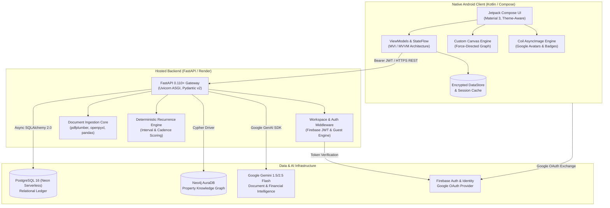
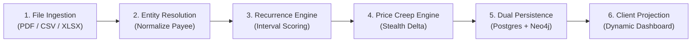
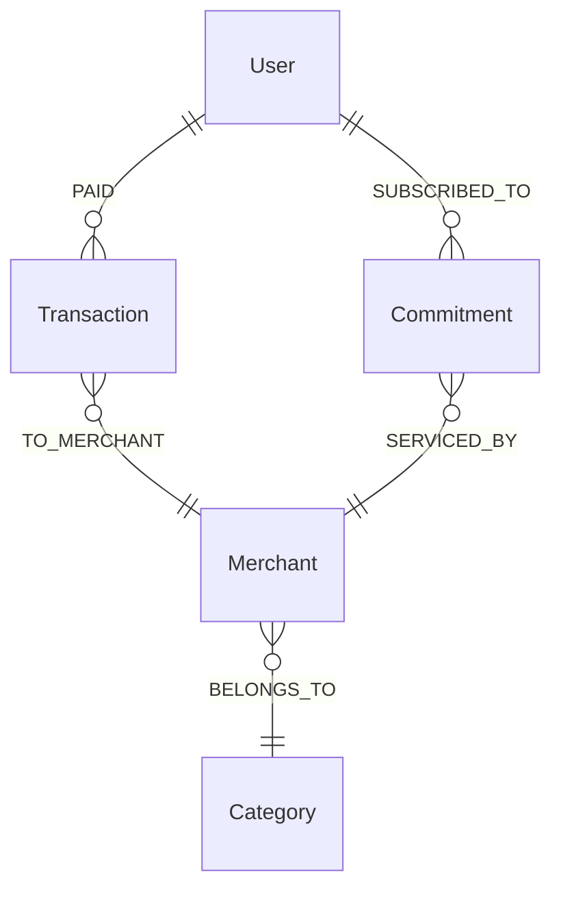
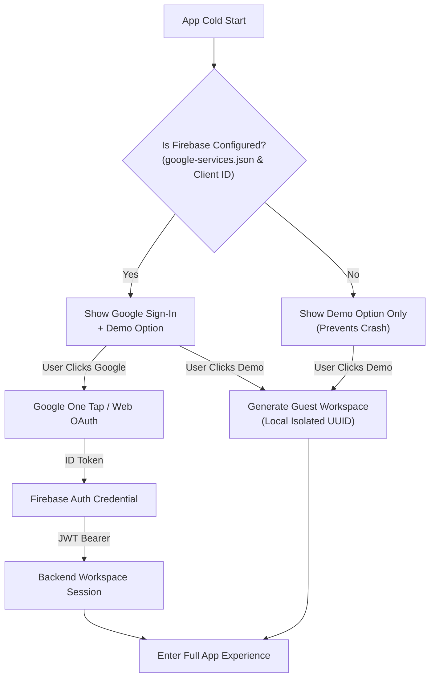

# PayScope — Complete Technical Architecture & System Specification

> **Document Type:** Production Engineering Architecture & Technical System Blueprint  
> **Application Name:** PayScope  
> **Tagline:** Unlock clarity with every payment.  
> **Client Platform:** Native Android (Kotlin, Jetpack Compose, Material3)  
> **Backend Platform:** FastAPI (Python 3.11+, Uvicorn, PostgreSQL, Neo4j, Gemini)  
> **Target Release:** v2.0 (Fintech Dark/Light Dynamic UI, Graph Canvas, PhonePe Architecture)  
> **Document Status:** Active Specification & Master Technical Reference  

---

## 1. Executive Overview & Product Vision

### 1.1 Problem Statement
Modern digital banking consumers encounter widespread **subscription sprawl**, **stealth price creep**, and **zombie recurring charges**:
- **Forgotten & Zombie Charges:** The typical digital user subscribes to 10–20 recurring services (streaming platforms, cloud storage, SaaS, fitness clubs, delivery passes). Over 30% of these persist unused.
- **Stealth Price Creep:** Service providers frequently raise monthly or annual subscription fees incrementally without explicit re-authorization, compounding silent annual cash drain.
- **Dark Patterns & Multi-Rail Cancellation Friction:** Cancelling recurring auto-debits is complicated by differing financial rails (UPI AutoPay, Credit Card Tokenization, NetBanking e-NACH mandates, Google Play / Apple App Store).
- **Privacy Intrusion of Traditional Aggregators:** Conventional personal finance management (PFM) apps force users to surrender primary net-banking passwords or link third-party data brokers, exposing sensitive credentials.

### 1.2 The PayScope Solution
**PayScope** is a privacy-first, offline-capable recurring payment tracker and financial intelligence ecosystem. It parses imported bank statements (PDF, CSV, XLSX, JSON) and SMS transaction streams, automatically identifies recurring cadence patterns, computes non-inflated mathematical aggregates, models payment connections in a property graph, and provides interactive Gemini AI financial assistance—**all without ever touching online banking credentials**.

```
┌────────────────────────────────────────────────────────────────────────┐
│                              PayScope                                  │
│                                                                        │
│   [Bank Statement Import] ──► [Recurrence Detection Engine]            │
│   (PDF / CSV / XLSX / JSON)              │                             │
│                                          ▼                             │
│   ┌──────────────────────────────────────────────────────────────┐     │
│   │  • Recurring Subscriptions Directory                         │     │
│   │  • Spending Analysis (Monthly & Yearly normalized spend)     │     │
│   │  • Stealth Price Creep & Anomaly Alerts                      │     │
│   │  • Interactive Knowledge Graph (Neo4j / Compose Canvas)      │     │
│   │  • What-If Savings Calculator (Accurate, non-double-counted) │     │
│   │  • Mechanism-Aware Cancellation Playbooks (UPI, Cards, NACH) │     │
│   │  • Embedded Gemini Financial Assistant                       │     │
│   └──────────────────────────────────────────────────────────────┘     │
└────────────────────────────────────────────────────────────────────────┘
```

---

## 2. End-to-End System Architecture

### 2.1 System Topology Diagram



### 2.2 Technology Stack Breakdown

| Layer | Component | Technologies & Libraries | Purpose |
|---|---|---|---|
| **Android Client** | Language & UI | **Kotlin 2.0**, **Jetpack Compose**, **Material 3** | Declarative modern UI with dark/light dynamic theme awareness |
| | Architecture | **MVVM + MVI**, **Coroutines**, **StateFlow** | Unidirectional data flow and structured concurrency |
| | Image Loading | **Coil Compose** (`io.coil-kt:coil-compose`) | High-performance asynchronous image caching with fallbacks |
| | Local Storage | **Jetpack DataStore** (Preferences) | Secure storage for tokens, user profiles, and theme preferences |
| | Networking | **Retrofit 2**, **OkHttp 3**, **KotlinX Serialization** | Type-safe REST client with automatic auth headers |
| **Backend API** | Framework | **FastAPI** (Python 3.11+), **Uvicorn** | High-throughput asynchronous REST API |
| | Data Validation | **Pydantic v2** | Strong schema validation and serialization |
| | ORM & Migrations | **SQLAlchemy 2.0 (Async)**, **Alembic** | Connection pooling and declarative relational mapping |
| **Database** | Relational Ledger | **PostgreSQL 16** (Neon Serverless) | Persistent storage for users, transactions, and commitments |
| | Knowledge Graph | **Neo4j 5.x / Neo4j AuraDB** | Cypher-queried graph representing spend flows & payee networks |
| **Intelligence** | LLM Engine | **Google Gemini 1.5 / 2.5 Flash** | Multimodal statement parsing, anomaly detection & chat assistant |
| **Identity** | Authentication | **Firebase Authentication**, **Google Sign-In** | Secure OAuth 2.0 tokens + instant zero-friction Guest mode |

---

## 3. Native Android Client Architecture

The mobile client is structured following **Clean Architecture** principles across four modular layers:

```
app/src/main/java/com/payscope/app/
├── core/
│   ├── components/      # Reusable UI widgets (UserAvatar, Buttons, Cards)
│   ├── notifications/   # System notification managers and handlers
│   ├── theme/           # Color palettes, Typography, ThemeManager (Dark/Light)
│   └── util/            # Date formatters, Currency helpers, Math utilities
├── data/
│   ├── api/             # Retrofit service interfaces and network models
│   ├── local/           # DataStoreManager, local caches, and preferences
│   ├── model/           # Data transfer objects (DTOs) and API responses
│   └── repository/      # Repository implementations (Auth, Dashboard, Graph)
├── domain/
│   └── model/           # Core domain entities (Transaction, Commitment, UserSession)
└── presentation/
    ├── alerts/          # Price creep & renewal notifications screen
    ├── analytics/       # Spend Insights, Category Breakdown, Velocity
    ├── assistant/       # PayScope AI Assistant modal sheet (Gemini Q&A)
    ├── auth/            # Google Sign-In and Guest onboarding flows
    ├── dashboard/       # Main Home Dashboard (PhonePe-inspired quick actions)
    ├── graph/           # Standalone Neo4j Relationship Graph (Canvas Engine)
    ├── history/         # Full Transaction History with search and filtering
    ├── navigation/      # Jetpack Compose Navigation Graph & routes
    ├── profile/         # Account details, email preferences, security
    └── savings/         # Interactive Savings Simulator & Goal Calculator
```

### 3.1 Dynamic Theme & Contrast Engine
- **Theme-Aware Palette:** Text and surface colors automatically adjust between Light and Dark modes. Text elements use `TextPrimary` and `TextSecondary` dynamically rather than hardcoded colors.
- **Canvas Rendering Support:** In [RelationshipGraphScreen.kt](file:///e:/payscopeAPP/app/src/main/java/com/payscope/app/presentation/graph/RelationshipGraphScreen.kt), Canvas text `Paint` instances bind to `TextPrimary.toArgb()` at draw-time, ensuring crisp legibility against any background.
- **Fintech Accent Highlights:** Maintains PayScope's signature purple (`#6F2DBD`), cyan (`#00E0E0`), and fiery orange (`#FF5500`) highlights for high-priority financial metrics.

### 3.2 Home Screen Architecture (PhonePe Design Pattern)
The Home Dashboard reflects modern Indian fintech UX standards (inspired by PhonePe):
1. **Top Header:** Clean, uncluttered layout with the circular **User Profile Avatar** anchored at the top-left (46dp size) and Notifications/Support on the right. The PayScope wordmark is omitted for maximum screen real estate.
2. **Account Balance Card:** Displays current liquidity, monthly spend trajectory, and active commitment counts.
3. **Quick-Access Grid:** Four icon-led options arranged in a single horizontal row with icons above labels:
   - **Analysis:** Direct shortcut to deep spending analytics and category distribution.
   - **Subscriptions:** Full directory of active recurring commitments.
   - **Savings Simulator:** Interactive target goal and budget simulator.
   - **Graph Analysis:** Standalone knowledge graph exploration.
4. **Spend Insights Card ("Ask PayScope AI"):** One-tap banner opening the interactive Gemini AI assistant.
5. **Recent Transactions:** Compact list of latest debits and credits with merchant badges.

---

## 4. The 6-Stage Data Ingestion & Analysis Pipeline



### 4.1 Stage 1: Document & Stream Ingestion
- **Input Channels:** Handles bank statement exports (PDF, CSV, XLSX, JSON) and incoming bank transactional SMS.
- **Structured Extraction:** Tabular bank statements are extracted using `pdfplumber` and `openpyxl`.
- **Gemini Multimodal Fallback:** Unstructured, photographed, or scanned statements are forwarded to Google Gemini document processing with strict JSON schemas, extracting `date`, `description`, `amount`, `type` (debit/credit), and `reference`.
- **Password Support:** Encrypted bank PDFs (e.g., PAN/DOB-protected) are decrypted in-memory before parsing without writing decrypted files to disk.

### 4.2 Stage 2: Entity Resolution & Cleaning
Raw bank narration strings are noisy (e.g., `UPI/432109876543/NETFLIX ENT/HDFC/MONTHLY`).
- The regex pipeline strips transaction IDs, bank routing headers, and payment rail tags.
- Normalized canonical merchants are matched against a curated merchant dictionary (e.g., `Netflix`, `Spotify`, `Amazon Prime`, `Hotstar`, `Airtel`, `Jio`).
- Categories are assigned deterministically (`Entertainment`, `Utilities`, `Software`, `Fitness`, `Food`).

### 4.3 Stage 3: Recurrence & Cadence Detection Engine
To separate one-time charges from actual subscriptions:
1. **Time Delta Analysis:** Computes intervals $\Delta t$ between consecutive payments to the same entity.
2. **Cadence Bucketing:**
   - **Weekly:** $\Delta t \approx 7 \text{ days}$ (tolerance $\pm 2$ days)
   - **Monthly:** $\Delta t \in [27, 34] \text{ days}$
   - **Quarterly:** $\Delta t \in [85, 95] \text{ days}$
   - **Yearly:** $\Delta t \in [350, 380] \text{ days}$
3. **Confidence Scoring:** Requires at least 2 observed cycles to mark a subscription as **Confirmed**. Single-charge services are classified as **Potential** candidates.

### 4.4 Stage 4: Stealth Price Creep Detection
- Tracks amount variations across billing cycles for confirmed subscriptions.
- If $Amount_{t} > Amount_{t-1}$ for identical service tiers, an anomaly is flagged.
- Alerts calculate annualized cumulative drain: $\Delta \text{Annual} = (Amount_{new} - Amount_{old}) \times \text{Cycles Per Year}$.

### 4.5 Stage 5: Dual Storage Synchronization
1. **Relational Ledger (PostgreSQL):** Stores immutable financial rows with foreign keys to workspaces, ensuring exact accounting.
2. **Knowledge Graph (Neo4j):** Projects transaction graphs to expose merchant dependencies, multi-card usage, and cross-category spending hubs.

### 4.6 Stage 6: Client Projection & Deterministic Math
- Aggregates are computed without double counting.
- Saved subscriptions project predictable future outflows on the Home Dashboard and Analytics screens.

---

## 5. Knowledge Graph Architecture (Neo4j & Canvas Engine)

### 5.1 Graph Data Model



- **Nodes:**
  - `User`: Workspace root identity.
  - `Transaction`: Individual debits with timestamp and amount properties.
  - `Merchant`: Standardized company or payee.
  - `Category`: High-level spending group.
  - `Commitment`: Active or paused subscription contract.
- **Edges:**
  - `(:User)-[:PAID]->(:Transaction)`
  - `(:Transaction)-[:TO_MERCHANT]->(:Merchant)`
  - `(:Merchant)-[:BELONGS_TO]->(:Category)`

### 5.2 Native Android Canvas Graph Engine
Unlike standard web apps that embed heavy WebViews, PayScope features a high-performance **Jetpack Compose Canvas** graph renderer:
- **Simulation:** Implements a force-directed layout simulation using velocity Verlet integration and repulsive Coulomb forces.
- **Touch Gestures:** Smooth pinch-to-zoom, two-finger pan, and node-tap selection.
- **Theme-Aware Typography:** Dynamic text measurement and contrast rendering via Android's native `android.graphics.Paint`.
- **Dynamic Category Filtering:** Real-time toggling of categories (e.g., Entertainment, Utilities, Cloud) with auto-rebalancing graph physics.

---

## 6. Artificial Intelligence Engine (Google Gemini)

### 6.1 Server-Side Gemini Intelligence
- **Model:** `gemini-1.5-flash` / `gemini-2.5-flash` via the Google Generative AI Python SDK.
- **Responsibilities:**
  1. **Scanned Statement OCR:** Extracts structured transaction tables from scanned or photographed PDF statements.
  2. **Predictive Budgeting:** Analyzes variable spend velocity to project end-of-month financial positions.
  3. **Contextual Q&A:** The backend feeds summarized, privacy-scrubbed financial context to Gemini to answer natural language questions (e.g., *"How much did I spend on food this month compared to last?"*).

### 6.2 PayScope AI Assistant Modal
Accessed via the **Spend Insights** banner on the Home and History screens:
- Real-time conversational interface built with Jetpack Compose.
- Quick prompt suggestions (*"Where can I cut expenses?"*, *"Summarize my subscriptions"*, *"Detect anomalies"*).
- Theme-aware chat bubbles with distinct styling for user prompts and assistant advice.

---

## 7. Dual Authentication & Session Architecture

### 7.1 Authentication Architecture



### 7.2 Safe Initialization Pattern
To prevent crashes on developer or open-source builds lacking `google-services.json`:
- `FirebaseAuth.getInstance()` is wrapped in `runCatching` blocks across `AuthRepository`, `DashboardViewModel`, and `ProfileViewModel`.
- If Firebase is uninitialized, the app gracefully degrades to **Demo/Guest Mode**, giving users access to fully functional offline sandbox data without crashing.

### 7.3 Google Profile Picture Integration
- Successful Google Sign-In extracts the user's avatar URL from the `FirebaseUser.photoUrl`.
- Stored locally in `DataStoreManager` under `KEY_USER_PHOTO_URL`.
- Rendered via Coil's `AsyncImage` with a circular crop and an `Icons.Default.Person` neutral fallback, eliminating arbitrary letter initials.

---

## 8. REST API Reference

The backend exposes a typed OpenAPI specification served at `https://payscope-api-ice5.onrender.com/`:

### 8.1 Health & Diagnostics
- `GET /api/v1/ready` — Checks relational database connection and Neo4j connectivity.
- `GET /api/v1/health` — Basic uptime verification.

### 8.2 Authentication & Workspaces
- `POST /api/v1/auth/google` — Exchanges Firebase ID token for a workspace session token.
- `POST /api/v1/auth/guest` — Creates a sandboxed 24-hour guest workspace with sample data.

### 8.3 Data Ingestion
- `POST /api/v1/upload/statement` — Accepts multipart PDF/CSV/XLSX files (up to 10 MB). Executes extraction, recurrence scoring, and graph synchronization.

### 8.4 Transactions & Commitments
- `GET /api/v1/transactions` — Paginated list of workspace transactions with search and filter parameters.
- `GET /api/v1/commitments` — Returns all detected recurring subscriptions, categorization, cadence, and price history.
- `PATCH /api/v1/commitments/{id}` — Update commitment status (Active, Paused, Cancelled).

### 8.5 Analytics & Intelligence
- `GET /api/v1/analytics/overview` — Aggregated monthly totals, category breakdown, and velocity.
- `GET /api/v1/graph/relationships` — Returns node and link graph data formatted for Canvas/SVG projection.
- `POST /api/v1/assistant/chat` — Context-aware financial assistant chat endpoint.

---

## 9. Build, Deployment & Verification Runbook

### 9.1 Environment Prerequisites
- **JDK:** Version 21 (Temurin / OpenJDK)
- **Android SDK:** API Level 35 (Android 15)
- **Python:** 3.11+ with `uv` package manager (for local backend development)
- **Connected Device:** Android 8.0+ (API 26+) with USB Debugging enabled

### 9.2 Android Build Commands

```powershell
# Run unit tests
.\gradlew.bat testDebugUnitTest

# Assemble Debug APK connected to hosted Render backend
.\gradlew.bat :app:assembleDebug -PPAYSCOPE_API_BASE_URL=https://payscope-api-ice5.onrender.com/

# Automated release build script
.\scripts\build-render-apk.ps1 -ApiUrl "https://payscope-api-ice5.onrender.com/"
```

### 9.3 Device Deployment via ADB

```powershell
# Check connected devices
adb devices

# Install APK onto physical phone
adb install -r output/android/payscope-render-debug.apk

# Launch app directly
adb shell am start -n com.payscope.app/com.payscope.app.MainActivity
```

---

## 10. Security & Privacy Guarantees

1. **Zero Secret Storage on Mobile:** No Gemini API keys, Neo4j admin passwords, or PostgreSQL database URLs are embedded in the compiled APK. All AI and graph operations run behind authenticated backend routes.
2. **Strict Workspace Multi-Tenancy:** Every database query and graph traversal is scoped by `workspace_id`. Cross-user data leakage is prevented at the ORM query level.
3. **Data Ephemerality:** Guest workspaces are assigned temporary session tokens and can be wiped instantly by the user or purged automatically after expiration.
